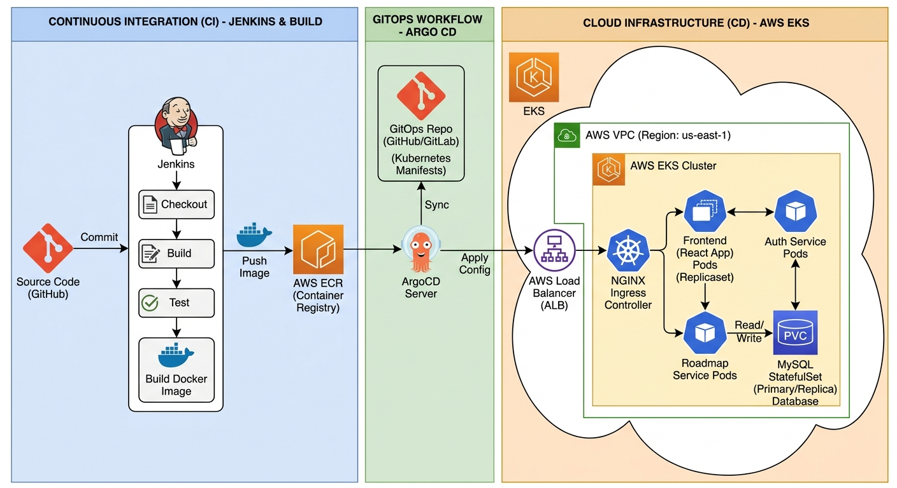

<div align="center">

# CloudDevOpsProject — iVolve

**An end-to-end DevOps platform for the iVolve microservices web application**
Graduation project built in collaboration with **iVolve Technologies** and the **National Telecommunication Institute (NTI)**


</div>

The project implements the complete software-delivery lifecycle: **containerization → infrastructure as code → configuration management → Kubernetes orchestration → continuous integration (Jenkins) → GitOps continuous deployment (ArgoCD)** — with every step reproducible from a single `terraform apply`.

---

## Table of Contents

- [Highlights](#highlights)
- [Application Overview](#application-overview)
- [Architecture](#architecture)
- [Repository Structure](#repository-structure)
- [Getting Started](#getting-started)
  - [Prerequisites](#prerequisites)
  - [Setup](#setup)
- [CI Pipeline](#ci-pipeline)
- [Kubernetes Resources](#kubernetes-resources)
- [Deliverables Map](#deliverables-map)
- [Teardown & Cost Control](#teardown--cost-control)
- [Roadmap](#roadmap)
- [Author](#author)

---

## Highlights

- **Strict GitOps split** — Jenkins never runs `kubectl`. It only updates Git; ArgoCD is the sole deployer, with automated `prune` + `selfHeal` against drift.
- **Zero static AWS credentials** — Jenkins pushes to ECR entirely through its EC2 instance IAM role.
- **Polyglot microservices, one platform** — Node.js, Python/Flask, and Java/Spring Boot services running side by side behind a single NGINX Ingress.
- **Fully reproducible & fully disposable** — the entire stack goes from nothing to running with `terraform apply` → one Ansible playbook → `Build Now`, and back to near-zero cost with a single teardown script.
- **Security built into CI** — every image is scanned with Trivy before it reaches ECR.

---

## Application Overview

iVolve is a microservices web application with user authentication and a DevOps roadmap page. The source code (originally from [Ibrahim-Adel15/iVolveFinalProject](https://github.com/Ibrahim-Adel15/iVolveFinalProject)) lives in this repository under `iVolveFinalProject/` (monorepo layout).

| Service | Technology | Port | Responsibility |
|---|---|---|---|
| `frontend` | Node.js / Express / EJS | 3000 | Web UI (auth page + roadmap page) |
| `auth-service` | Python / Flask | 5000 | Signup & login; only service that talks to MySQL |
| `roadmap-service` | Java / Spring Boot | 8080 | Roadmap data |
| `MySQL` | MySQL 8 | 3306 | Stores users (`ivolve.users`) |

**Traffic flow:** Browser → `frontend` → (`auth-service` \| `roadmap-service`) → `auth-service` → MySQL.

---

## Architecture

[](screenshots/arch.png)

### Toolchain & Rationale

| Tool | Responsibility | Why it was chosen |
|---|---|---|
| GitHub | Single source of truth | App code, IaC, pipelines, manifests, and docs all versioned together |
| Docker / Compose | Containerization, local testing | Reproducible builds per microservice |
| Terraform | AWS provisioning (Network, Server, EKS, ECR modules) | Versioned, destroyable, reproducible infra; S3 backend + DynamoDB locking |
| Ansible | Jenkins server config + cluster bootstrap | Idempotent, agentless, role-based configuration management |
| Amazon EKS | Orchestration | Self-healing, rolling updates, service discovery, 2-AZ HA |
| Amazon ECR | Container registry | Private, IAM-secured image storage |
| Jenkins | CI | Automated Build / Scan / Push / Update-Manifests / Push-Manifests pipelines |
| Trivy | Security scanning | Vulnerability visibility inside CI |
| ArgoCD | CD (GitOps) | Cluster continuously converges to Git; drift detection & self-heal |

### Key Design Decisions

- **GitOps split:** Jenkins never runs `kubectl apply`. It only updates Git; ArgoCD performs all deployments.
- **IAM roles over static keys:** Jenkins pushes to ECR via its instance role — no hardcoded AWS credentials anywhere.
- **StatefulSet + headless Service + StorageClass** (`ebs-sc`, gp3, `WaitForFirstConsumer`) for MySQL: stable identity, direct pod addressing, AZ-aware EBS volumes.
- **`directory.recurse: true`** in the ArgoCD app, since manifests live in `database/` and `microservices/` subfolders.
- **`strategy: Recreate`** on Deployments: guarantees clean rollouts on a small 2-node cluster.
- **Teardown ordering:** add-on Load Balancers are removed (and AWS is waited on) *before* VPC deletion, to avoid `DependencyViolation` errors.

---

## Repository Structure

```
.
├── ansible/
│   ├── inventory/aws_ec2.yml
│   ├── playbook.yml
│   ├── cluster-bootstrap.yml
│   ├── cluster-teardown.yml
│   └── roles/
├── argocd/application.yaml
├── docker-compose.yaml
├── infrastructure_terraform/
│   ├── network/
│   ├── server/
│   ├── eks/
│   ├── ecr/
│   └── backend.tf
├── iVolveFinalProject/
├── jenkins/
│   ├── <service>/Jenkinsfile
│   └── shared-library/vars/
├── kubernetes/
│   ├── namespace.yaml  configmap.yaml  secret.yaml  storageclass.yaml  ingress.yaml
│   ├── database/
│   └── microservices/
├── screenshots/
├── setup.sh / teardown.sh
└── README.md
```

---

## Getting Started

### Prerequisites

- AWS account with configured CLI
- GitHub account with a Personal Access Token (`repo` scope)
- Local tools: `terraform`, `ansible`, `docker`, `kubectl`, `helm`, `git`
- AWS Session Manager plugin (for SSM-based Ansible connections):

```bash
curl -O https://s3.amazonaws.com/session-manager-downloads/plugin/latest/ubuntu_64bit/session-manager-plugin.deb
sudo dpkg -i session-manager-plugin.deb
```

### Setup

**1. Test the application locally**

```bash
docker compose up --build     # → http://localhost:3000
docker compose down
```

**2. Provision infrastructure**

```bash
cd infrastructure_terraform
terraform init
terraform apply -auto-approve     # VPC, Jenkins EC2, EKS (2 AZs), ECR
```

**3. Configure the Jenkins server**

```bash
cd ../ansible
ansible-playbook -i inventory/aws_ec2.yml playbook.yml
```

**4. Bootstrap cluster add-ons & GitOps**

```bash
ansible-playbook cluster-bootstrap.yml
# Installs NGINX Ingress + ArgoCD, then applies argocd/application.yaml.
# ArgoCD then deploys everything in kubernetes/ automatically.
```

**5. One-time Jenkins UI configuration**

1. **Credential** `github-pat` (Kind: Username with password — your GitHub username + PAT).
2. **Global Pipeline Library**: name `ivolve-shared`, default version `main`, repository = this repo, **Script Path `jenkins/shared-library`**.
3. **Three pipeline jobs** (Pipeline from SCM, branch `*/main`), script paths: `jenkins/frontend/Jenkinsfile`, `jenkins/auth-service/Jenkinsfile`, `jenkins/roadmap-service/Jenkinsfile`.

**6. Run CI/CD**

Click **Build Now** on each job. Jenkins builds → scans (Trivy) → pushes to ECR → updates the image tag in `kubernetes/` → commits to GitHub → **ArgoCD syncs EKS**.

**7. Access everything**

| What | How |
|---|---|
| App | `kubectl get svc -n ingress-nginx` → open EXTERNAL-IP/hostname |
| ArgoCD UI | `kubectl get svc argocd-server -n argocd`; password: `kubectl -n argocd get secret argocd-initial-admin-secret -o jsonpath="{.data.password}" \| base64 -d` |
| Jenkins | EC2 public DNS / ALB, port 8080 |

> **Note:** live infrastructure is torn down between demos to control AWS cost. The steps above rebuild the entire environment from scratch in a few commands.

---

## CI Pipeline

Each microservice has its own Jenkinsfile, but all logic lives in the shared library (`jenkins/shared-library/vars/*.groovy`) so the pipelines stay thin and identical in structure.

| Stage | What it does |
|---|---|
| Build Image | `docker build` from `iVolveFinalProject/<service>` |
| Scan Image | Trivy (HIGH/CRITICAL report, `--ignore-unfixed`) |
| Push Image | ECR login via IAM role → tag `:<BUILD_NUMBER>` → push |
| Delete Image Locally | Keeps the Jenkins agent clean |
| Update Manifests | Rewrites `image:` in the service's Deployment YAML |
| Push Manifests | Commits `[skip ci] Deploy <svc> build N` to GitHub |

---

## Kubernetes Resources

| File | Kind | Purpose |
|---|---|---|
| `namespace.yaml` | Namespace | Isolated `ivolve` environment |
| `configmap.yaml` | ConfigMap | Non-sensitive config (DB host/port/name, service URLs) |
| `secret.yaml` | Secret | DB credentials |
| `storageclass.yaml` | StorageClass | `ebs-sc` — gp3, `WaitForFirstConsumer` |
| `database/mysql-statefulset.yaml` | StatefulSet | MySQL with persistent EBS volume |
| `database/mysql-headless-svc.yaml` | Service (headless) | Stable pod DNS, no load-balancing |
| `microservices/*-deployment.yaml` | Deployment ×3 | Stateless apps, `Recreate` strategy |
| `microservices/*-svc.yaml` | Service ×3 | Internal discovery |
| `ingress.yaml` | Ingress | External access to `frontend` via NGINX (`ivolve-ingress`) |

---

## Deliverables Map

| # | Requirement | Location |
|---|---|---|
| 1 | GitHub repository | this repo |
| 2 | docker-compose | `docker-compose.yaml` |
| 3 | Terraform modules + S3 backend | `infrastructure_terraform/` |
| 4 | Ansible roles + dynamic inventory | `ansible/` |
| 5 | Kubernetes YAMLs | `kubernetes/` |
| 6 | Jenkins pipelines + shared library | `jenkins/` |
| 7 | ArgoCD Application | `argocd/application.yaml` |
| 8 | Documentation | this README + `screenshots/` |

---

## Teardown & Cost Control

```bash
./teardown.sh
# = ansible-playbook cluster-teardown.yml   (release LBs, wait for AWS cleanup)
# + terraform destroy -auto-approve
```

Intentionally kept between teardowns (near-zero cost): ECR images, S3 state, DynamoDB lock table.

---

## Roadmap

- GitHub webhook → auto-trigger pipelines on push
- Jenkins Configuration-as-Code (JCasC) for zero-manual Jenkins setup
- HTTPS + custom domain (cert-manager + Route53)
- Helm charts / Kustomize overlays for dev–staging–prod environments
- HPA + Karpenter for elastic scaling; Argo Rollouts for canary deployments
- Sealed Secrets / External Secrets; Kyverno policy gates; network policies
- Observability stack: Prometheus + Grafana, Loki logs, alerting
- Velero backups of MySQL/EBS to S3 with restore drills

---

## Author

**Anis Emad** — DevOps graduation project, NTI × iVolve Technologies
[GitHub](https://github.com/AnisEmad)
